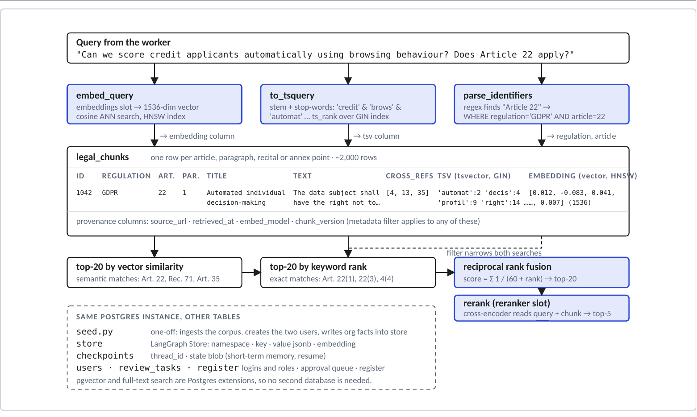
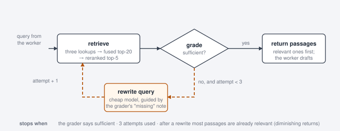

# The worker agent

The worker is the heavy model working as an agent inside the orchestrator, called for every full assessment. Given the validated feature description and the long-term memory, it decides for itself which tools to call and in what order: it looks the register up, searches the law one topic at a time, fetches an article it already knows it needs, reads the results, and returns an assessment in a fixed structure (verdict, severity-tagged findings with citations, next steps, DPIA and high-risk-AI flags) or, when that is the right answer, a short status reply. Every tool call passes through the tool gate ([TOOLS.md](TOOLS.md)); every model call passes through the middleware stack in section 3.

## 0. Two agents, one machinery

The worker assesses a feature from scratch. The reviser runs only after the DPO has requested changes to the feature: it takes v1, the requested changes, the product manager's done / not-possible answers and the old and new description (all placed into its first message by the `pm_revision` node, the pause in which the thread waited for the product manager, so the agent looks nothing up), decides the consequence of each change for v1's findings (closed, narrowed, kept, or a new finding), searches the law only for what changed, and copies every untouched finding over unchanged. Both are built from the same model slot, tools, middleware stack and tool gate; only the instructions, the inputs and the trigger differ (`nodes/reviser.py`, `build_reviser` in `nodes/worker.py`). The output guardrail treats a revision like any assessment and adds two rules: the "changes since v1" section must be there, and a request marked "not possible" keeps its finding open.

## 1. From a query to legal passages

One query, three lookups, one list:

1. The worker's query is embedded (embeddings slot, 1536 dims) and searched by cosine similarity on the `embedding` column (HNSW index).
2. The same query is stemmed into a `tsquery` and ranked by keyword match on the `tsv` column (GIN index); terms are OR-ed and results ordered by how many terms matched.
3. Identifiers in the query ("Article 22(1)", "Recital 71", "Annex III point 5(b)") become exact `WHERE` lookups on the metadata columns.
4. The three lists are merged by reciprocal rank fusion (identifier hits weighted higher) into a top-20.
5. A cross-encoder reranker (Rerank 4 Fast) reads query and chunk together and keeps the best five.

Each chunk is one article, numbered paragraph, recital or annex point with its citation label, so the worker cites exactly what it retrieved and the output guardrail can verify every label against the same table.

## 2. The agentic RAG loop

- **retrieve**: the three lookups, the fusion and the reranking of section 1, giving five passages.
- **grade**: a grader (cheap slot, structured output) judges whether those five answer the central question of the query; it answers "sufficient?" with a yes / no, its certainty, the relevant passages and, when not sufficient, the one provision that is missing.
- **rewrite query**: the cheap model rewrites the query using the grader's "missing" note and the queries already tried, and the loop goes back to retrieve with attempt + 1.
- **return passages**: grader-relevant passages first, then supporting context up to k; the worker drafts from them.

**Stopping criteria.** The loop ends when the grader says sufficient; when three attempts have been used; or when, after a rewrite, the grader already marks most passages relevant and only side topics are missing (diminishing returns). The tool then returns what it has and the worker decides how to proceed, usually with a separate, narrower search.

## 3. Middleware

`PIIMiddleware` (e-mail, credit card, IP, phone): redacts or masks personal identifiers in messages entering the model, covering tool results and the DPO's comments that the input guardrail never sees.

`SummarizationMiddleware` (traced, project prompt): when a thread passes 60k tokens, condenses the older messages on the cheap slot and keeps the last 24. The user's request (the feature description, or the revision brief) is never part of what gets condensed: it is pinned in front of the summary unchanged, so a condensed thread cannot lose its task; the cheap model that writes the summary is shown that request plus the last 12k tokens of the older part (the stock middleware would show it only the last 4k, which for a long thread never contain the request) and is asked for the deliverable still owed and the findings so far with their exact citation labels. A single assessment stays far below the threshold; the trace reports "thread summarised (N older messages → summary, the request itself kept verbatim)" when it fires.

`ToolBudgetMiddleware`: a per-run budget of 14 tool calls, counting real tools only (the Assessment / StatusReply that ends a run is delivered as a tool call too and must never be blocked); when reached the agent is asked to finish with what it has.

`RoleToolsMiddleware` (ours, `wrap_model_call`): binds only the tools the caller's role may use and places the recalled long-term memory (org facts, standing positions, the user's preferences) into the system prompt for each model call. If the memory store cannot be read, the error is logged and the trace shows "long-term memory unavailable"; the model never runs with silently empty memory.

`ToolGateMiddleware` (ours, `wrap_tool_call`, the human-in-the-loop middleware): re-checks the role on every tool call, refuses repeated identical calls, creates the review task and calls `interrupt()` for `request_dpo_review`, and applies the DPO's decision (approve writes the register, reject records nothing) when the thread resumes. Details in [TOOLS.md](TOOLS.md).
