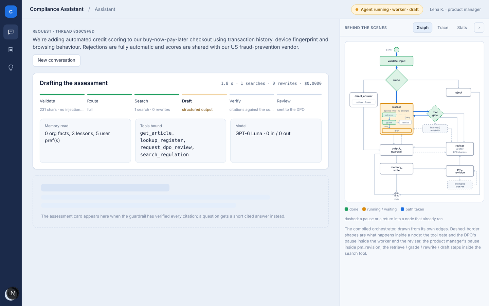
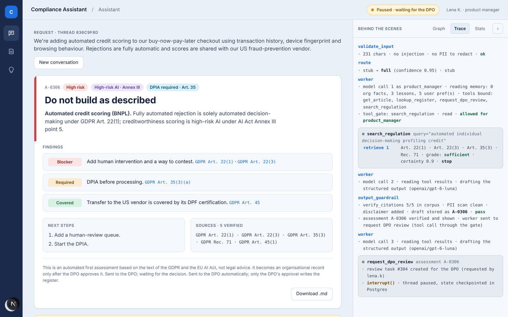
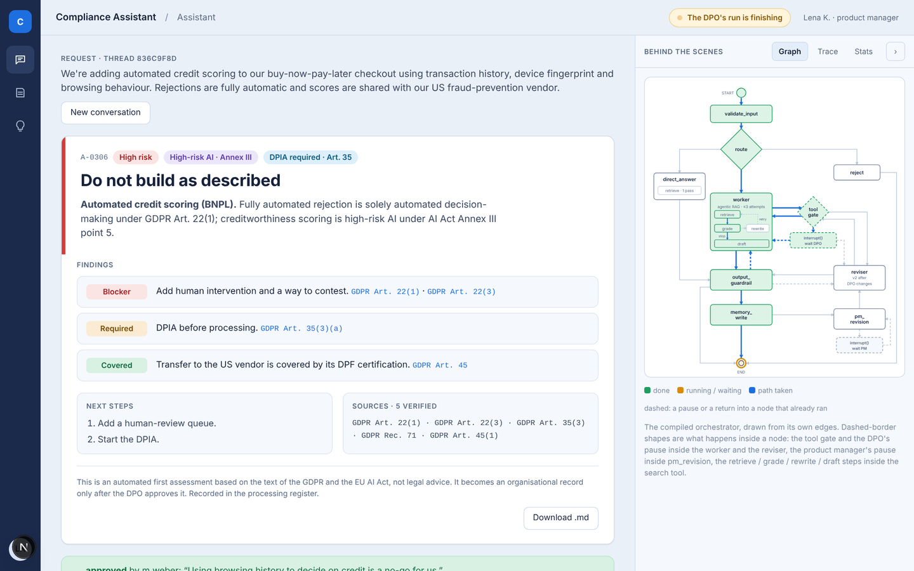
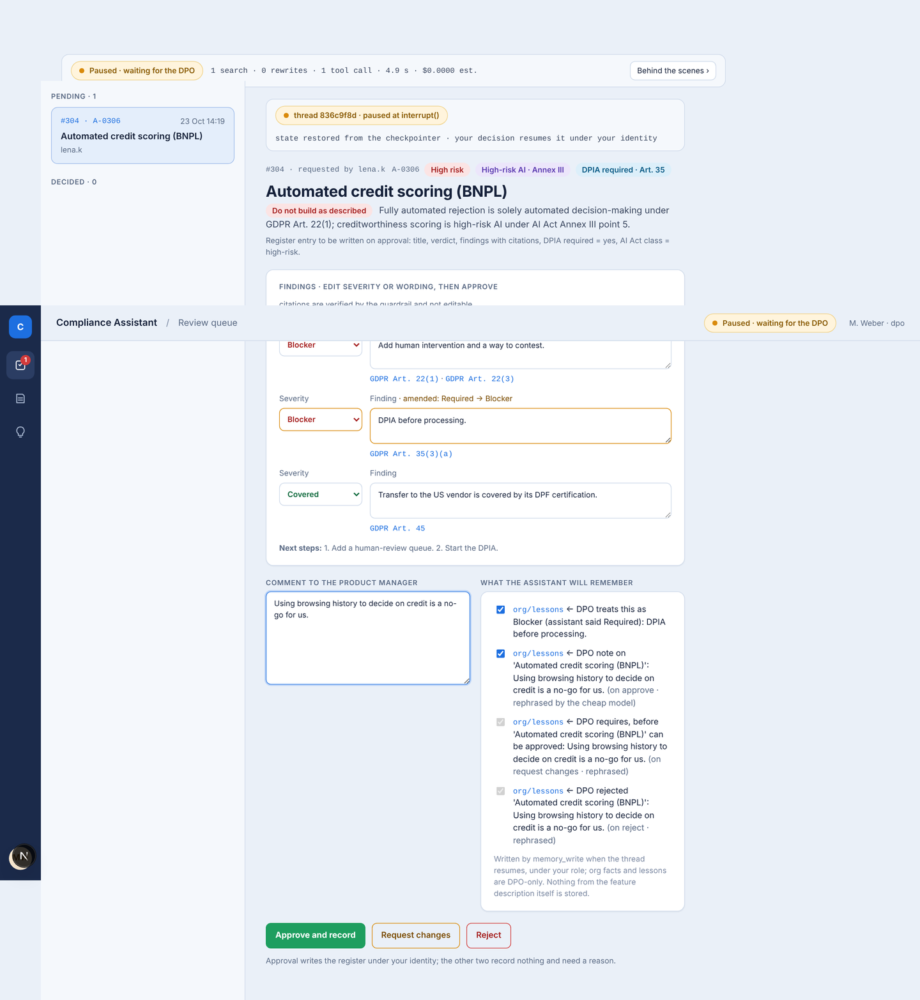
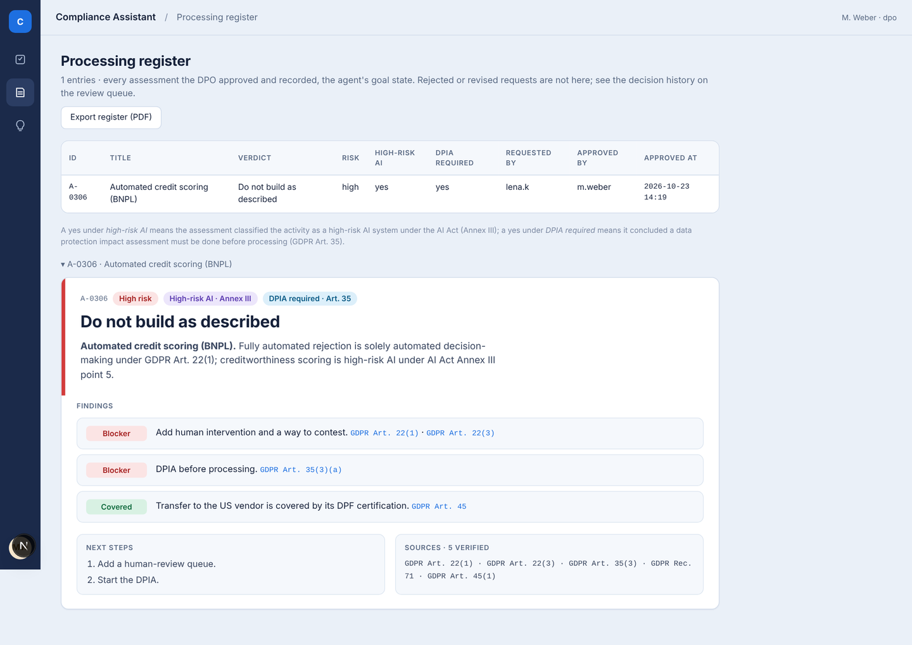
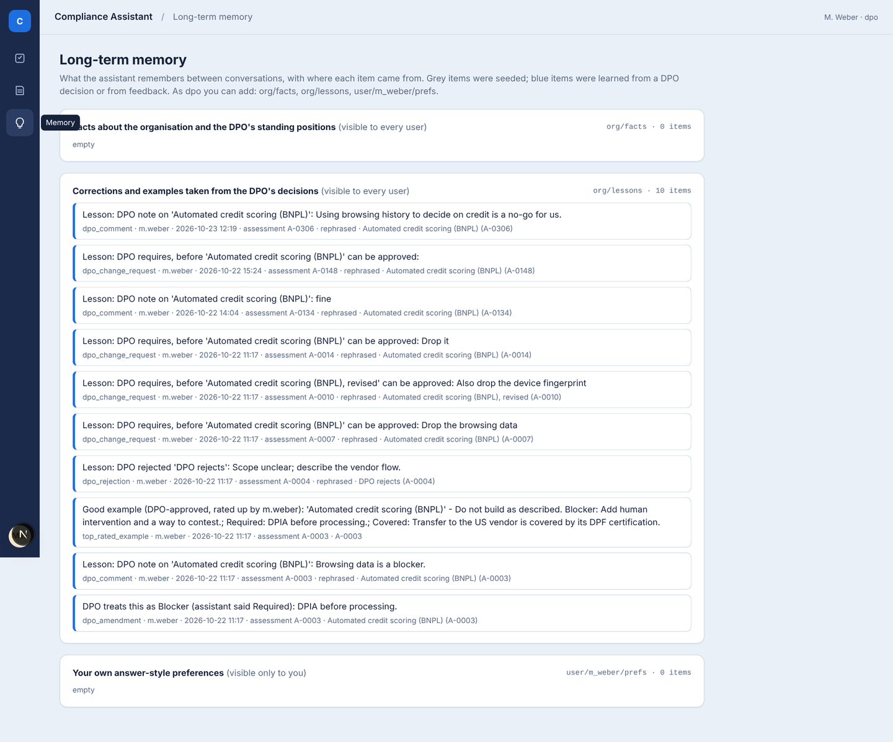
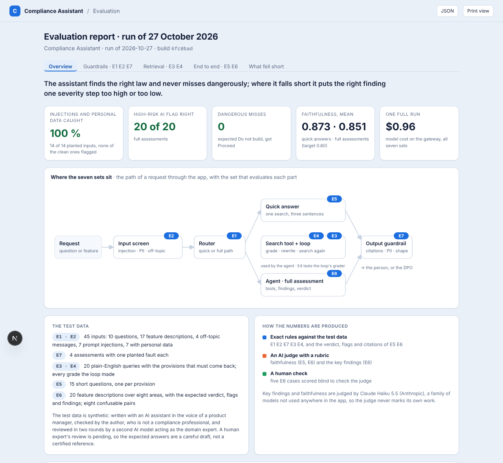
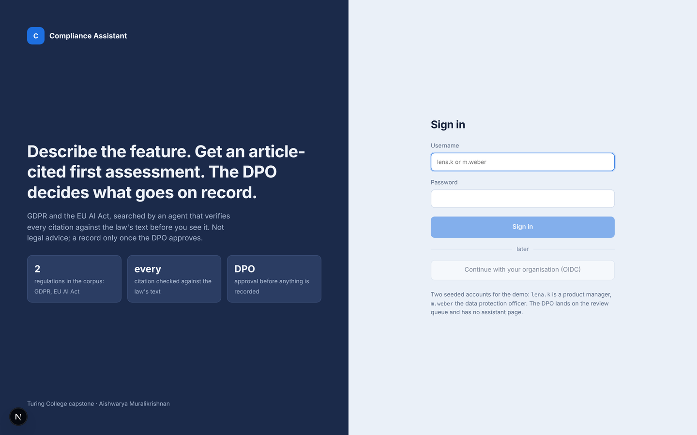

# The web app

The app is a React (Next.js) front end over the FastAPI backend in `api/` (design: [docs/web_app_design.md](docs/web_app_design.md)). It opens on a login screen, where we can log in as a product manager `lena.k` or as the Data Protection Officer (DPO) `m.weber`. Every page keeps the same frame: a narrow rail on the left with the pages the role may open and the user's avatar (click to log out), a top bar with the page name and a status pill that says what the agent is doing on the current thread (*Agent running · worker · draft*, *Paused · waiting for the DPO*, *Run complete · approved*), the page content in the middle, and **Behind the scenes** on the right: the live graph, the trace and the run stats of the thread's runs, which opens by itself while a run streams and otherwise folds to a one-line strip with the run's figures and a button to open it again. The session is a cookie in the browser, so two roles side by side need two browser profiles (a normal and a private window, or two browsers), not two tabs.

## Progress card

While a run streams, the page shows a progress card in place of the result: a horizontal stepper read off the run's events, three facts under it (the memory the agent read, the tools bound for the role, the model with its token counts) and a placeholder for the card that is coming. The steps follow the path the run actually takes. A feature description runs Validate (characters, injection and PII flags) → Route (the tier and its confidence) → Search (searches and rewrites so far) → Draft (the structured output) → Verify (the guardrail's citation check) → Review (sent to the DPO; the thread pauses); a question runs Validate → Route → Answer → Verify; a rejected input stops at a red Rejected step. A resumed run shows its own steps, because nothing before the pause runs again: the DPO's decision shows Decision (approved, changes requested or rejected, by whom, and whether the register entry was written) → Worker (reports the outcome to the requester) → Verify → Memory (the items stored), plus a Revision step when changes were requested; the product manager's revision shows Revision (revised description received) → Search → Draft (v2, changes since v1) → Verify → Review; a preference note or a kept example shows Feedback → Memory.

## Behind the scenes

**Graph.** The orchestrator drawn as a flowchart, from the compiled graph's own edges (a test pins the drawing to the graph; the one exception is the graph's self-loop on `pm_revision`, a refused resume that asks again, which is drawn as the round trip through its interrupt box). The active node is amber, visited nodes green, the edges actually taken blue. Solid arrows are the forward path; dashed arrows are a pause or a return into a node that already ran (a resume out of an `interrupt()`, a regeneration, the automatic review request, the retry inside the worker); a legend under the graph says so. Three shapes with a dashed border are not nodes of the compiled graph but stand for what happens inside one, as do the thin retrieve / grade / rewrite / draft boxes inside the worker: the tool gate (middleware around every tool call inside the worker's and the reviser's `tools` node), the `interrupt() · wait DPO` box (the pause raised inside that gate, so its resume continues inside the agent) and the `interrupt() · wait PM` box (the pause raised inside `pm_revision`). The worker box shows its inner control flow (retrieve → grade → draft, with the grade → rewrite → retrieve loop), the direct-answer box its single retrieval pass. A quick answer runs route → direct_answer → output_guardrail → END and a rejected input route → reject → END; after a full assessment the path runs `output_guardrail` → `worker` → `tool_gate` → `interrupt()` and stops there (memory_write and END stay unlit) until the DPO decides. The picture accumulates over the thread's runs: the decision continues the same path rather than starting a new one, drawn from the pause it comes out of (START, validate_input and route stay grey, the `interrupt()` box it left is green), so the graph reaches END only after the DPO has decided. After *Request changes* the path continues `memory_write` → `pm_revision` → its own `interrupt() · wait PM` box, which stays amber until the product manager runs her revision; her resume lights `interrupt() · wait PM` → `pm_revision` → `reviser`, the reviser's tool calls go through the same tool gate as the worker's, and the run pauses at the gate again. The drawing's layout is served once by the API (`GET /api/meta/graph-layout`) and the state of every run with its events, so the page and the server cannot disagree about the picture; `python scripts/draw_graph.py` writes the compiled graph itself as Mermaid, outer and x-ray (`docs/images/compiled_graph.png`, `compiled_graph_xray.png`).

**Trace.** One block per node, in the order they ran, stacked for every run of the thread: validation flags, the router's tier and confidence, the worker's model calls with the memory it read and the tools bound, every tool call and the gate's decision on it, each `search_regulation` call in its own grey box with the retrieval rows (`retrieve 1 … grade: sufficient · certainty 0.91 · stop`, rewrites in between; the grader's reason for an insufficient verdict is a hover tooltip), the guardrail's citation check, and the memory node's stored / not-stored lines. After a DPO decision the resumed run's blocks follow under the first run's; after a preference note or a kept example a `feedback` block is appended. A reloaded page gets the traces of every run this API process executed on the thread back (`views` in the thread body), so nothing depends on having watched the run live.

**Stats.** The figures of the latest run: current step, searches (calls of the search tool), retrieve passes (every retrieval inside them, so passes minus searches is the number of retries after a rewrite), rewrites, tool calls, tokens in / out, cached (the input tokens the provider served from its prompt cache, priced at the cached rate in `config/models.yaml`), estimated cost, elapsed time and the thread id. The estimate covers the calls the graph streams back, i.e. the worker's, the reviser's and the quick answer's model calls; the helper calls inside the search tool (grader, query rewrite, reranker, embeddings), the input screen and the router are not in it, so the gateway's activity page shows a higher figure for the same run (about $0.18 against an estimated $0.13 for the stage-3 case on Mistral Large 4, 22 Oct). The gateway is the figure to quote. Under the tiles, **Models per node** lists every node of the graph with the model behind it (for instance `worker` · GPT-6 Luna, `worker · search_regulation · grader` · GPT-6 Luna, `worker · search_regulation · rewrite` · Gemini 3.1 Flash Lite). It is display only: models are chosen in `config/models.yaml` by whoever runs the app, not in the UI, so that a user without knowledge of the models cannot switch a node to an expensive one and run up costs. The last line says whether LangSmith tracing is on.

## Pages and who can do what

| Page | Product manager (`lena.k`) | DPO (`m.weber`) |
|---|---|---|
| Assistant | describe a feature or ask a question, read the result, revise after a change request, leave a note | no access |
| Review queue | no access | landing page: decide on requests |
| Register | read | read and export as PDF |
| Memory | read | read |

**Assistant.** A request box and *Run assessment*; one request per conversation, and *New conversation* starts the next. The request stays at the top of the page with its thread id; under it the progress card while the agent works, then the result: for a question a short cited answer with its sources (or, when the quick model returned no text, a band that says so instead of an empty card); for a feature the assessment card, with the verdict as its headline, the flags (risk level, high-risk AI, DPIA required), the summary, the findings tagged Blocker / Required / Covered with their citations, the next steps, the sources with how many were verified, the disclaimer and *Download .md*. A rejected input shows the reason in a red band. While the thread waits for the DPO a band says so and the page polls every four seconds; the DPO's decision run appears in Behind the scenes as it happens, and when it is done the card gets the outcome band under it (approved and recorded, changes requested, rejected, in the DPO's words) and a preference note box ("What should the assistant do differently next time?", stored as this user's own preference; for a quick answer the box is there at once). A run that has not finished after five minutes is reported as such rather than waited for. After *Request changes* the thread is paused for the product manager (`pm_revision`) and the page shows the revision form: the requested changes, a done / not possible choice with a note for each, and the description box pre-filled with the previous text; *Run revision* resumes the paused thread with her answers and the revised text, the reviser agent runs and v2 goes to the DPO like any assessment, with "Changes since v1" above its findings. A revised description that fails the screen (too short, instructions to the assistant) is not accepted: the form shows the reason and the thread stays paused for another attempt. Only the requester can revise her own thread.

**Review queue.** The pending requests on the left (and, under them, the decided ones with their outcome); selecting one restores the paused thread and shows the review form: the assessment with severity and wording editable per finding (citations are verified by the guardrail and not editable), a comment box, "What the assistant will remember" (the memory items the decision would store, each with a checkbox, rephrased before storing), and the three decisions: *Approve and record*, *Request changes* (the feature must change; the requested changes go in the comment box, one per line) and *Reject* (needs a reason). For a revised assessment (v2) a folded line above the form, *Previous version A-… and what you asked for*, opens v1 and the requested changes next to v2. The decision resumes the product manager's thread under the DPO's identity: the progress card shows the decision's steps, Behind the scenes its run (interrupt → worker → output_guardrail → memory_write, and on to `pm_revision` after *Request changes*, where the thread pauses for the product manager), and the outcome band follows; an approved decision has a *Keep as a good example* button (stores the approved assessment as a lesson), and *Next request* moves on. The list refreshes every five seconds, so a revision that comes back lands in the queue without a reload.

**Register.** Every recorded entry with its verdict, risk, the high-risk-AI and DPIA ticks, who requested and who approved; each entry unfolds to the full assessment, and an entry that revises an earlier assessment shows its history (v1, the requested changes, v2). For the DPO, *Export register (PDF)*: the overview table plus every recorded assessment in full, with the DPO's comment, for audits.

**Memory.** The long-term store with provenance, in three sections that say what they hold and who sees them: facts about the organisation and the DPO's standing positions (visible to every user), corrections and examples taken from the DPO's decisions (visible to every user), and the current user's own answer-style preferences (visible only to them). Seeded items are grey, learned items blue, each with source, author, time and assessment id; a rephrased item keeps the original wording underneath.

**Evaluation (public, outside the app).** The evaluation report (`eval/README.md`, section 7) is not a page for the product manager or the DPO: it is for whoever reviews the project, so it lives at `/evaluation`, needs no login, and is linked from the login page ("How well does it work?"). Six tabs: Overview (where the seven sets sit in the app, the test data and how its numbers are produced, the strongest numbers, the cost of a run, what the run does not show), Legal domains (the nine areas of the two regulations drawn inside their regulation's band with the articles each rests on, and the confusable pairs as three short tables with the run's result for each pair), Guardrails (E1 router, E2 input screen, E7 output guardrail), Retrieval (E3 search with and without the agentic loop as tiles and bars, the queries a single search missed as cards, E4 grader as tiles and its decision matrix), End to end (E5 quick answers as tiles and one cell per question; E6 full assessments in four themes, the verdict, the two flags, citations and key findings with a picture of what a key finding is and how the judge scores one, and checks on the scoring; the per-case table folded under "Per case") and What fell short (the gap to each target not met as a bar, then the failure modes with one example each). Each set says what it tests and on what data before its numbers; no tab shows a metric table, the definitions are printed at the end of the print view; *Print view* lays the tabs out in sequence with the definitions at the end, and that view printed is `eval/report/evaluation.pdf` (`scripts/eval_pdf.py`). A band says so when no run exists.

## Login

The login page states what the app does (an article-cited first assessment of a feature against the GDPR and the EU AI Act, every citation checked against the law's text, the DPO's approval before anything is recorded) and takes the user name and password of one of the two seeded accounts, or, when the deployment has a Google client configured, a **Sign in with Google** button under the form (OpenID Connect; built 2 Nov, `docs/deployment_design.md`): a first sign-in creates a product manager account from the verified e-mail address, the addresses on the administrator's allowlist sign in as DPO, and a refused sign-in comes back to this page with the reason in plain words. The session is a signed cookie that lasts eight hours in both cases.

