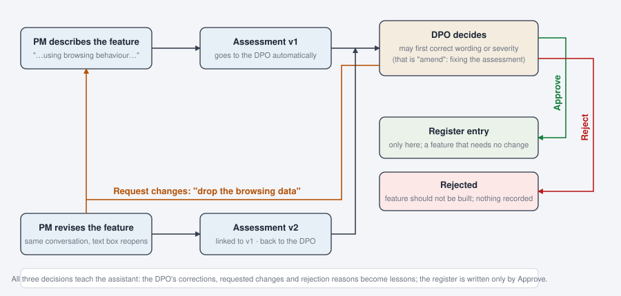

# Design: "Request changes" and the revision agent

Status: built (21 Oct 2026); this note stays as the design record. Section 2 (how the revision enters the graph) is superseded by `revision_design_v2.md`, which turns the revision into a pause for the product manager inside the same run. The README, UI.md, TOOLS.md and AGENTWORKER.md describe the current result.

## 1. What changes for the people



- The DPO gets a third decision. **Approve** (the feature is fine as described; the register is written), **Request changes** (the *feature* must change; nothing is written), **Reject** (the feature should not be built; nothing is written). *Amend* stays what it is: correcting the assessment's wording or severity before approving.
- After *Request changes* the product manager sees the DPO's requested changes under the assessment, in the same conversation, and the text box reopens pre-filled with the previous description. For each requested change she answers **done** (and edits the description accordingly) or **not possible, because …**. Then she presses *Run revision*.
- A second agent, the **reviser**, produces assessment v2: it works out the legal consequence of what the PM changed, finding by finding, and leaves the rest of v1 untouched. v2 opens with a "Changes since v1" section and goes to the DPO automatically, like any assessment.
- The register records only the version the DPO approved; the entry shows its history (v1 → requested changes → v2).

## 2. The graph

One new node. Everything downstream of it is reused.

```
START → validate_input → route ─┬→ direct_answer ──────────────┐
                                ├→ worker   (assess from scratch)│→ output_guardrail → (request review) → memory_write → END
                                ├→ reviser  (v2 from v1 + changes)┘
                                └→ reject → END
```

- `route` becomes deterministic for a revision: before asking the classifier, it checks whether this thread has an assessment in status `changes_requested`; if so the tier is `revise` and the next node is `reviser`. No model call decides this.
- `reviser` is a second `create_agent` with its own system prompt and the same middleware stack as the worker (role tools, memory, PII, summariser, tool gate). Same tools, same gate, same guardrail: only the instructions, the inputs and the trigger differ. That is what makes it a second agent rather than the worker called twice.
- `output_guardrail` treats a reviser output exactly like a worker output: citations verified, PII scanned, schema checked, stored as a draft, shown to the PM, then the automatic review request through the gate and the pause. One extra rule, see section 5.
- The gate's `request_dpo_review` branch learns the third decision: `request_changes` resolves the review task with status `changes_requested`, sets the assessment status to `changes_requested`, and returns to the worker a status reply "The DPO requested changes: … Tell the user what must change." The run then finishes through the guardrail and memory_write as a rejection does today.

## 3. The reviser

Inputs, assembled by the app into the first message of the revision run (the agent never has to look them up):

- v1 as stored (findings with severities and citations, verdict, flags, next steps);
- the DPO's requested changes, one per line, with her comment;
- the original and the revised feature description;
- the PM's answer per requested change: done / not possible + reason.

Instructions (the whole difference from the worker):

1. Answer the requested changes, one by one. For each, say what the PM changed and the consequence for the assessment: a finding is **closed** (the issue is gone), **narrowed** (still applies, smaller scope or lower severity), **kept** (unchanged, with the reason), or a finding is **new** (the change introduced an issue v1 never saw, for instance browsing data replaced by location history). Search the law only for what changed.
2. A requested change marked *not possible* keeps its finding and its severity; say so. The verdict may not become "Proceed" while a Blocker is open.
3. Copy every finding the requested changes do not touch from v1 unchanged, wording and citations included. Do not re-assess them.
4. Output the same `Assessment` structure as the worker, plus `changes_since_v1`: one entry per requested change `{request, pm_response, outcome: closed|narrowed|kept|new, finding, explanation}`, and `revises: "A-0038"`.

Output schema: `Assessment` gains two optional fields, `revises: str | None` and `changes_since_v1: list[ChangeNote] | None`. The worker never fills them; the guardrail requires them when the route is `revise`.

Cost: a revision runs one or two targeted searches, a few cents.

## 4. Data

- `assessments`: status gains `changes_requested`; two new columns, `revises` (the previous assessment id, null for v1) and `version` (1, 2, …). v2 is a new row with its own id, linked to v1 by `revises`. Nothing is overwritten, so the history is the chain of rows.
- `review_tasks`: status gains `changes_requested`; `dpo_comment` holds the requested changes (one per line).
- `register`: unchanged, plus `revises` copied from the approved assessment so the entry can show its history.
- Graph state: `revision: dict | None` carries `{v1_id, requests, responses, previous_text}` for the one run that needs it; `route` gains the literal `revise`.

## 5. Guardrail rules added

- On the `revise` route the output must be an `Assessment` with `revises` and `changes_since_v1` filled; a status reply or a missing section is sent back once, as a missing assessment is today.
- If any PM response is *not possible* and the verdict is "Proceed", the draft is sent back once with the rule quoted. Deterministic, no model needed.
- Carried-over findings pass through the same citation check as everything else; a label that no longer resolves is treated as today.

## 6. UI

- **Review queue**: a third button, *Request changes*, next to *Approve and record* and *Reject*. It requires the requested changes in the comment box, one per line; the "What the assistant will remember" list shows the resulting lesson. A v2 request shows "Changes since v1" above the editable card, and the DPO can open v1 beside it.
- **Assistant** (PM): when the thread's assessment is `changes_requested`, the card shows a "Requested changes" block; under it, per change, a radio *done* / *not possible* with a reason box; the text area reopens pre-filled; the button reads *Run revision*. After v2 is approved the card shows "Approved as v2 (revises A-0038)".
- **Register** and the **PDF**: an entry whose assessment revises another gets a "History" expander / section: v1 summary, the requested changes with date and DPO, v2's changes-since section.
- **Live graph**: a `reviser` box beside the worker, sharing the drawn tool gate; the layout test pins the new edges (`route → reviser`, `reviser → output_guardrail`).
- **Trace**: the reviser's model calls appear under `reviser`; a `changes since v1` line per request.

## 7. Memory

- *Request changes* writes one lesson, like a rejection: "DPO requires: …" (rephrased, original kept). Approval of v2 writes nothing new beyond the usual amendments and comment.

## 8. Tests (scripted model, scratch database)

- v1 → DPO requests changes → task and assessment statuses, lesson proposed, thread completed, PM thread shows the request.
- PM revision run → route is `revise` without a classifier call → reviser output stored as v2 with `revises` → automatic review request → DPO approves → register row with `revises`, v1 row untouched.
- *Not possible* + verdict "Proceed" → guardrail sends the draft back once.
- Reviser output without `changes_since_v1` → sent back once.
- Layout test still pins the drawn graph to the compiled one.

## 9. Demo

Stage 8 becomes the revision loop instead of a rejection: the DPO requests "drop the browsing data" on Lena's stage-7 request; Lena marks it done, removes it from the description and runs the revision; v2 arrives with "Changes since v1" on top; the DPO approves; the register shows two entries, the second with its history. Reject is mentioned as the third decision, not demonstrated.

## 10. Build order and effort

1. Data and gate: statuses, columns, the `request_changes` branch, the lesson (half a day).
2. Reviser node, prompt, schema fields, deterministic route, guardrail rules (half a day).
3. UI: DPO button, PM revision form, register history, PDF, trace and graph (half a day).
4. Tests, run sheet, README / UI.md / TOOLS.md / AGENTWORKER.md updates (half a day).

About two days. Order relative to the rest: the two hidden-failure fixes first (an hour), then this, then the evaluation harness, so the golden set describes the final flow.
