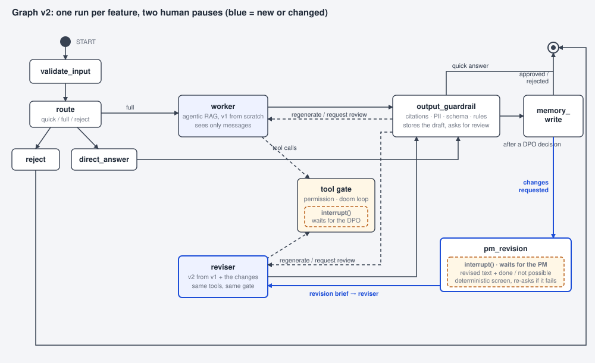

# Design v2: the revision as a pause for the product manager

Status: built (22 Oct 2026); this note stays as the design record. It replaces section 2 of `revision_design.md` (v1, built on 21 Oct); everything v1 says about the people, the reviser's instructions, the data and the guardrail rules stays. The difference is purely architectural: how the revision gets into the graph.

## 1. What is wrong with v1

In v1 the DPO's *Request changes* ends the run (status reply → guardrail → memory_write → END) and the product manager's revised description starts a **new** run through START → validate_input → route, where the router recognises "this thread has an assessment waiting for changes" and picks the reviser without calling its classifier. It works, but the router is doing a job that is not routing, the reviser is briefed by the app from the database instead of by the graph from its own state, and the live graph shows the revision as a second conversation rather than as the loop it is.

## 2. The change

One run per feature, from the first description to the register entry, with two human pauses made by the same mechanism, `interrupt()`:



- The tool gate pauses for the **DPO** (as today). On *Request changes* the resumed run continues through the agent's status reply, the guardrail and `memory_write` (the DPO's requirement is stored as a lesson there, under her identity, as today), and then, instead of ending, goes to a new node.
- **`pm_revision`** pauses for the **product manager** with `interrupt()`. Its payload carries what her page needs: the requested changes, the DPO's comment, the previous description and the id of v1. Her *Run revision* is a resume of the thread, not a new turn. The node screens the resumed text deterministically (section 4), writes the revision into the state, puts the reviser's brief into `messages`, and the graph proceeds to the reviser.
- The **reviser** runs as before (same model slot, tools, middleware, gate) and its v2 goes through the guardrail to the gate, which pauses for the DPO again. *Approve* writes the register and the run ends through `memory_write`; *Request changes* loops back into `pm_revision` (v3, and so on); *Reject* ends the run.

The edges in words: `output_guardrail → memory_write` after every DPO decision; `memory_write → END` when the decision was approve or reject, `memory_write → pm_revision` when it was request changes; `pm_revision → reviser`; `reviser → output_guardrail`; the dashed `output_guardrail → reviser` for a regeneration and for the automatic review request stays. Removed: `route → reviser` and the deterministic branch inside `route`; the router is a classifier again.

What stays identical for the people: the DPO's three buttons, the product manager's revision form (done / not possible per change, the pre-filled text box, *Run revision*), "Changes since v1" on v2, the register history and the PDF.

## 3. The `pm_revision` node

```python
def pm_revision(state):
    cr = repo.change_request_for_thread(thread_id)              # v1 and the DPO's task; idempotent on replay
    payload = {"type": "pm_revision", "revises": v1.id, "title": v1.title, "requests": cr.requests,
               "comment": task.dpo_comment, "requested_by": task.resolved_by,
               "previous_description": v1.description, "error": None}
    while True:
        answer = interrupt(payload) or {}                       # pauses; replayed with the resume value
        if resumer is not the thread's requester (role product_manager, same user_id):
            payload["error"] = "only the requester can revise this feature"; continue
        text, flags, reason = screen_revision(answer["description"])   # deterministic, section 4
        if reason:
            payload["error"] = reason; continue                  # asks again, the thread stays paused
        break
    revision = {"revises": ..., "requests": ..., "responses": answer["responses"], "comment": ...,
                "previous_description": ..., "v1": v1.assessment}
    return {"messages": [HumanMessage(revision_brief(revision, text))], "input": text,
            "validation": {"ok": True, "flags": flags, ...}, "revision": revision, "route": "revise",
            "assessment": None, "structured_response": None, "review_requested": False, "regenerations": 0,
            "decision": None}
```

- The loop is LangGraph's documented pattern for validating human input: every `interrupt()` call in the node is replayed with its resume value, so a failed screen simply pauses again with `error` filled, and the page shows the reason above the form.
- The resume value is `{"description": str, "responses": [{"status": "done" | "not_possible", "note": str}, ...]}`, one response per requested change, in the DPO's order.
- Identity: a resumed run executes under the identity in `config["configurable"]`, so the reviser runs as the product manager, with the product manager's tools, exactly as the worker did for v1. The node refuses a resume by anyone but the thread's requester (the DPO cannot revise a feature on the PM's behalf; another PM cannot take over a thread).
- `revision_brief` is unchanged; the node builds it from the state and the assessment row instead of the app building it from the database. The brief labels the revised description as the product manager's text, not instructions.

## 4. Screening the second input

The first input goes through `validate_input`: hard limits, PII redaction, an injection regex and the cheap-model screen (injection and on-topic verdicts). The revised description is screened inside `pm_revision` with the **deterministic** parts only: limits, `redact_pii`, the injection regex; no model call. Reasons, to be stated in TOOLS.md:

- the on-topic verdict is meaningless for a revision (the thread is an assessment of this feature already);
- the input comes from an already-screened user continuing her own thread, and everything the reviser produces still passes the output guardrail (citations, PII scan, the two revision rules) and the DPO;
- a resume should be fast and must not fail because a helper model is unavailable.

If the text fails, the node re-interrupts with the reason instead of ending the turn, which is a better outcome than today's reject path. `validate_input` itself is unchanged for fresh turns.

## 5. State

New key `decision: str | None` (`approved` | `changes_requested` | `rejected`), written by the guardrail on the status path after a DPO decision (read from the review task), cleared by `pm_revision`; it drives the conditional edge after `memory_write`. `revision` and `route = "revise"` are written by `pm_revision` instead of by `run_turn`. `Route` keeps the literal `revise` so the guardrail and the trace know which agent produced the draft.

Who may write what does not change: the agents see only `messages` and `structured_response` (their subgraph schema); `assessment` is written only by the guardrail after verification; the review task, the assessment rows and the register are written only by the gate and the guardrail through `repo`.

## 6. App and graph API

- `graph.pending_kind(state)` returns `"dpo"` for a `dpo_review` interrupt and `"pm"` for a `pm_revision` interrupt.
- `resume_turn(user, thread_id, payload)` is used for both resumes; `run_turn` loses its `revision` parameter and `revision_payload` goes away.
- **Assistant page**: while the thread waits for the PM (`pending_kind == "pm"`), the page shows the requested changes, the form and the pre-filled box from the interrupt payload (not from a database lookup), plus the error line when a screen failed; *Run revision* calls `resume_turn`. While it waits for the DPO, as today. Polling already handles both.
- **Review queue**: a *Request changes* decision now ends with the live graph at `memory_write → pm_revision → interrupt()` and the outcome line "waiting for the product manager's revision" instead of END.
- **Live graph**: a `pm_revision` box with its `interrupt()` sub-box next to `memory_write`; edges as in section 2; the layout test pins them to the compiled graph. **Trace**: a `pm_revision` block ("waiting for the product manager: 2 requested change(s)", "revised description received · 2 answers · 0 PII redactions · injection check ok", or "rejected: … → asked again").

## 7. Tests (scripted model, scratch database)

Changed: the two revision tests resume the thread instead of starting a turn; the layout test learns the new edges. Added: a resume by the DPO or another user is refused and the thread stays paused; a revised description that fails the screen is asked again with the reason and the next resume succeeds; a second *Request changes* on v2 loops back to `pm_revision`. Unchanged: everything else, including the cut-off handling and the register history.

## 8. Docs and demo

README 2.3 and 3.2 (the loop and the node table), UI.md (Assistant page, live graph, trace), TOOLS.md (the gate's third branch and the screening note), AGENTWORKER.md (the reviser's input now comes from `pm_revision`), TECHNICAL.md (state key, test count), `workflow.svg` and `orchestrator_graph.svg` regenerated, run sheet stages 8 to 8c (the DPO's decision pauses for Lena; Lena's page updates by itself).

## 9. Effort and order

About a day: node and edges with the state key (2 h), app changes (2 h), viz and trace (1 h), tests (2 h), docs, drawings and run sheet (2 h). Built on the current files; the v1 route branch is removed only once the new tests pass, so the working demo is never without a revision path.
